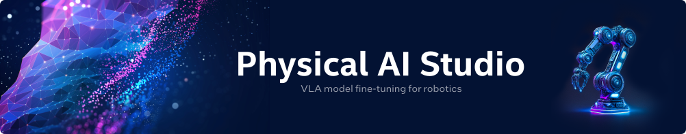
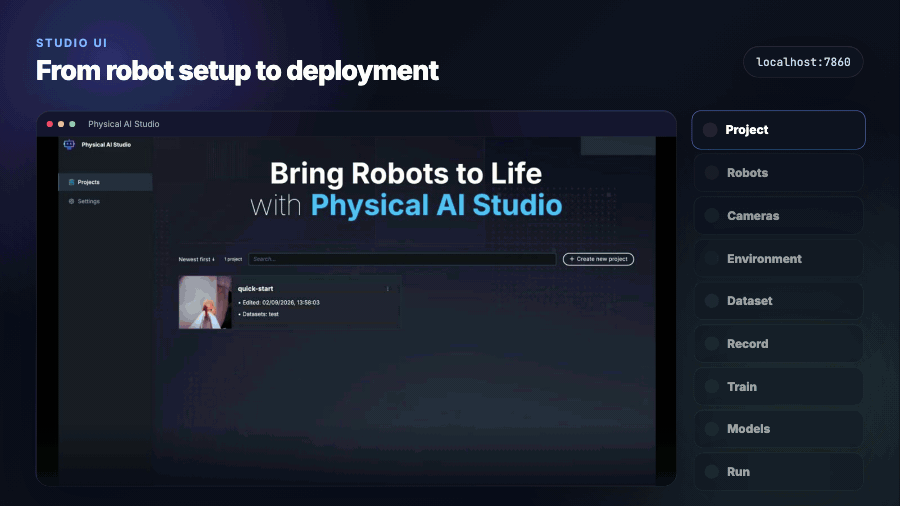

<p align="center">
  
</p>

<div align="center">

**Physical AI Studio — Extended with the SO-101 Model-Based Manipulation Studio**

[SO-101 Manipulation Studio](#so-101-model-based-manipulation-studio) • [User Journey](#user-journey) • [Kinematics, Jacobians & Dynamics](#kinematics-jacobians-ik--dynamics-reference) • [REST API](#so-101-manipulation-studio-rest-api) • [Upstream Studio UI & CLI](#studio-ui)

</div>

---

## SO-101 Model-Based Manipulation Studio

This extension integrates a general-purpose, **model-based SO-101 Manipulation Studio** directly into Physical AI Studio (`application/backend/src/so101_architecture/`, `application/backend/src/api/so101_architecture.py`, and `application/ui/src/routes/so101-architecture/`).

Instead of requiring demonstration collection and neural policy training before moving a robot, users with any **SO-101 Leader or Follower arm** and any camera configuration (`0..N` cameras) can compose vision, symbolic skills, kinematics, and control blocks into a standalone Python policy.

### User Journey

The interface is organized around a progressive, unnumbered five-stage workflow so users can focus on one layer at a time while retaining access to every analytical tool:

- **Architecture**: Compose a Simulink-style block diagram from reusable camera sources, computer vision blocks (HSV + watershed segmentation, 3D point-cloud registration, eye-in-hand visual servoing, CIE-Lab color delta, OpenVINO PatchCore anomaly detection), a bilevel symbolic skill planner, and control blocks (5-DOF inverse kinematics, 6×5 Jacobian velocity control, published CAD gravity compensation).
- **Skills & Waypoints**: Name, add, edit, reorder, and delete custom symbolic operators (`SymSkill` / NSRT skills) with STRIPS preconditions, expected post-condition atoms, target waypoints, and gripper apertures. Preview joint poses, teach waypoints directly from a physical Leader arm, or solve waypoints from World XYZ coordinates.
- **Live Twin & Control**: Interact with a clean 3D kinematic arm skeleton viewport alongside Leader/Follower joint controls, live `/observations/ws` Leader streaming, CAD posture bridging, and live camera feeds (`0..N` cameras with optional inspection overlays).
- **Kinematics & Calibration**: Switch between Forward & Inverse Kinematics, the 6×5 Geometric Jacobian & manipulability metrics, Published CAD Dynamics ($M(q)$, $g(q)$, center of mass), and a single-pose Upright Reference Calibration Wizard for any new SO-101 arm.
- **Deploy**: Inspect and copy the compiled standalone Python policy (`so101_compiled_policy.py`) or download the standalone controller (`.py`), calibrated URDF (`.urdf`), and complete architecture bundle (`.json`).

---

## Kinematics, Jacobians, IK & Dynamics Reference

| Module | Mathematical Formulation |
|---|---|
| **Unit Bridge** | Converts between Physical AI Studio `normalized` ($[-100, 100]$), Homed STS3215 `ticks` ($0..4095$), Calibrated Encoder `q_enc_rad` ($2\pi/4096\text{ rad/tick}$), LeRobot `degrees` ($360/4095\text{ deg/tick}$), and `so101-cad.urdf` `q_cad_rad`. |
| **Forward Kinematics** | Product of exponentials across `Revolute_1..Revolute_5` in both `Body5_1` base frame and REP-103 World frame ($+X$ forward, $+Y$ left, $+Z$ up from the table surface at $z_0 = +29.33\text{ mm}$). |
| **6×5 Geometric Jacobians** | Analytical spatial/body Jacobians $J_{\text{rad}}(q) \in \mathbb{R}^{6\times 5}$, $J_{\text{tick}}(q) = \frac{2\pi}{4096} J_{\text{rad}}(q)$, and $J_{\text{deg}}(q)$, together with Yoshikawa manipulability $w_5(q) = \sqrt{\det(J^T J)}$, singular values, and condition number $\kappa(J)$. |
| **Published CAD Dynamics** | Registered Onshape CAD link inertials (`632.006 g` across 6 links plus configurable payload mass): whole-arm Center of Mass, $5\times 5$ Joint-Space Mass Matrix $M(q)$, Gravity Torque vector $g(q)$ ($\text{N}\cdot\text{m}$), % of STS3215 stall torque (`2.94 Nm`), and feedforward gravity tick offsets. |
| **5-DOF Inverse Kinematics** | Pure-NumPy damped Gauss-Newton solver minimizing 3D target position, approach pitch, and jaw yaw residuals subject to per-arm joint limits. |

---

## SO-101 Manipulation Studio REST API

Mounted at `/api/so101/*` (`application/backend/src/api/so101_architecture.py`):

- `GET /api/so101/state?project_id=<uuid>` — Full studio snapshot (`studio_db`, `composer`, `calibration`, `arms`, `kinematics`, `dynamics`, `waypoints`, `cameras`, `trajectory`)
- `POST /api/so101/compile-graph` — Validate a custom block diagram & custom symbolic skill sequence and compile into a standalone Python policy (`so101_compiled_policy.py`)
- `POST /api/so101/sync-project` — Sync `SO101_Leader` & `SO101_Follower` calibrations and cameras from `physicalai.db`
- `POST /api/so101/kinematics` — Compute FK, 6×5 Jacobians, manipulability, and CAD dynamics for any joint state
- `POST /api/so101/ik` — Solve 5-DOF Grasp/Placement IK for `target_xyz_world`, `pitch_down_deg`, `jaw_yaw_deg`
- `POST /api/so101/teach` — Capture Leader or Follower posture and save to a task waypoint
- `POST /api/so101/align` — Derive `cad_at_zero_rad` and `cad_sign` from upright reference ticks
- `POST /api/so101/bowls` — Update target XYZ coordinates and re-solve waypoints via 5-DOF IK
- `GET /api/so101/inspection` & `POST /api/so101/inspection` — Optional live anomaly inspection evidence bridge
- `GET /api/so101/export` — Export standalone Python controller, calibrated URDF, and JSON architecture bundle
- `GET /api/so101/camera/{top,plate,wrist}.jpg` — Fetch live camera frame or fallback preview

---

## Studio UI

Collect demonstrations, train policies, and run inference through a visual interface.

<!-- markdownlint-disable MD033 -->
<p align="center">
  
</p>
<!-- markdownlint-enable MD033 -->

[Start Studio with Docker](./application/docs/01-installation.md#install-with-docker-recommended) · [Native setup](./application/docs/01-installation.md#alternatively-install-natively)

<details>
<summary>Copy Docker start commands</summary>

```bash
git clone https://github.com/open-edge-platform/physical-ai-studio.git
cd physical-ai-studio/application/docker
cp .env.example .env
./setup-devices.sh --cpu # or --xpu or --cuda
docker compose up -d
```

Open <http://localhost:7860>. See the [Docker guide](./application/docker/README.md) for hardware options and setup. Configure `HF_TOKEN` in `application/docker/.env` for Hugging Face-backed policies; see [Hugging Face integration](./application/backend/docs/huggingface_integration.md).

</details>

<details>
<summary>Native development commands</summary>

In one terminal, from the repository root:

```bash
cd application/backend
uv run --extra xpu physicalai-studio serve # or --extra cpu / --extra cuda
```

In a second terminal, also from the repository root:

```bash
cd application/ui
npm install
npm run start
```

Open <http://localhost:3000>.

</details>

## Documentation

[Library](./library/README.md) · [Application](./application/README.md) · [Contributing](./CONTRIBUTING.md)
