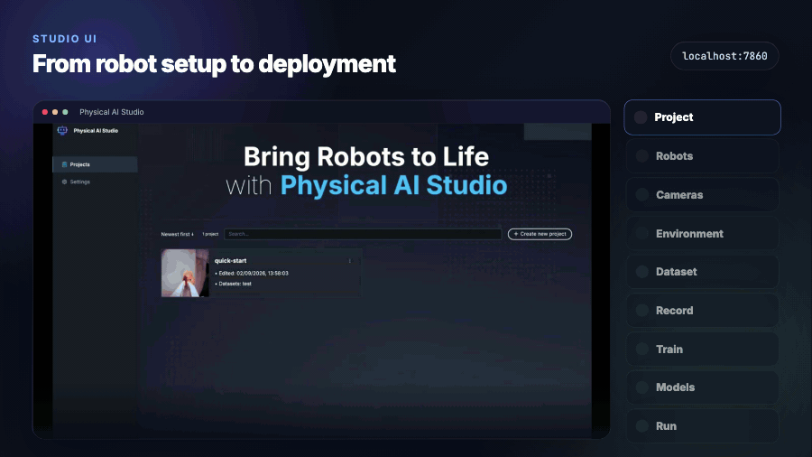
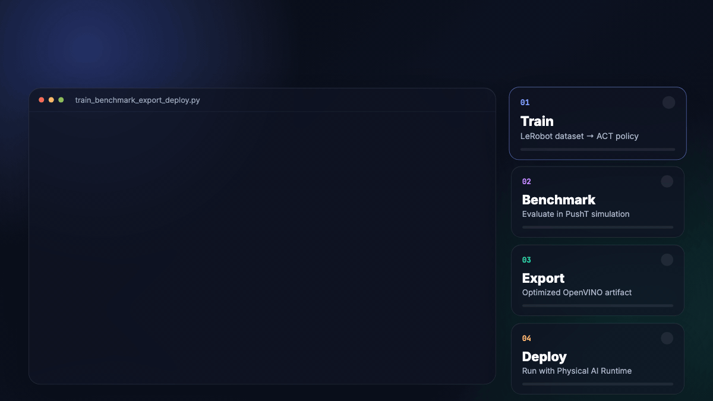

<p align="center">
  
</p>

<div align="center">

**Physical AI Studio helps teams train, benchmark, and deploy robot policies from demonstrations.**

[Studio UI](#studio-ui) • [Python API](#python-api) • [CLI](#cli) • [Policies](#policies) • [Install](#install) • [Documentation](#documentation)

</div>

---

## Studio UI

Collect demonstrations, train policies, and run inference through a visual interface.

<!-- markdownlint-disable MD033 -->
<p align="center">
  
</p>
<!-- markdownlint-enable MD033 -->

[Start Studio with Docker](./application/docs/01-installation.md#install-with-docker-recommended) · [Native setup](./application/docs/01-installation.md#alternatively-install-natively)

<details>
<summary>Copy Docker start commands</summary>

```bash
git clone https://github.com/open-edge-platform/physical-ai-studio.git
cd physical-ai-studio/application/docker
cp .env.example .env
./setup-devices.sh --cpu # or --xpu or --cuda
docker compose up -d
```

Open <http://localhost:7860>. See the [Docker guide](./application/docker/README.md) for hardware options and setup. Configure `HF_TOKEN` in `application/docker/.env` for Hugging Face-backed policies; see [Hugging Face integration](./application/backend/docs/huggingface_integration.md).

</details>

<details>
<summary>Native development commands</summary>

Native setup is for contributors and requires OS-level libraries, [uv](https://docs.astral.sh/uv/getting-started/installation/), and [Node.js v24](https://nodejs.org/en/download). See the [prerequisites](./application/docs/01-installation.md#prerequisites).

In one terminal, from the repository root:

```bash
cd application/backend
uv run --extra xpu physicalai-studio serve # or --extra cpu / --extra cuda
```

In a second terminal, also from the repository root:

```bash
cd application/ui
npm install
npm run start
```

Open <http://localhost:3000>. For native Hugging Face setup, use **Settings > General > Hugging Face**.

</details>

## Python API

Train, benchmark, and export policies programmatically.

<!-- markdownlint-disable MD033 -->
<p align="center">
  
</p>
<!-- markdownlint-enable MD033 -->

The library also supports LIBERO and RoboCasa benchmarks; see the [benchmarking guide](./library/docs/getting-started/first-benchmark.md) for suite-specific setup and checkpoint requirements.

<details>
<summary>Copy the Python example</summary>

```python test="skip" reason="requires dataset download and robot observation"
from physicalai.benchmark.gyms import PushTBenchmark
from physicalai.data import LeRobotDataModule
from physicalai.inference import InferenceModel
from physicalai.policies import ACT
from physicalai.train import Trainer

datamodule = LeRobotDataModule(repo_id="lerobot/pusht", num_workers=0)
policy = ACT()

trainer = Trainer(max_epochs=100)
trainer.fit(model=policy, datamodule=datamodule)

benchmark = PushTBenchmark(num_episodes=50)
results = benchmark.evaluate(policy)

policy.export("./exports/act", backend="openvino")
runtime_policy = InferenceModel("./exports/act")
```

</details>

A PushT-trained policy is not directly usable on a physical robot; use a policy trained for that robot with a matching Runtime config. See the [robot deployment guide](https://github.com/openvinotoolkit/physicalai/blob/main/docs/getting-started/run-a-policy.md).

## CLI

Run Studio training, benchmarking, and export from Runtime's `physicalai` CLI; Runtime also provides the `run` command for deployment.

<details>
<summary>Copy the CLI commands</summary>

The example configs live in `library/configs`; run these Studio commands from `library/` in a cloned repository:

```bash
# From the repository root
cd library

# Train on PushT
physicalai fit \
  --config configs/physicalai/act/pusht/default.yaml

# Benchmark the trained checkpoint
physicalai benchmark \
  --config    configs/benchmark/pusht.yaml \
  --policy    physicalai.policies.ACT \
  --ckpt_path experiments/lightning_logs/version_0/checkpoints/last.ckpt

# Export for deployment
physicalai export \
  --policy     physicalai.policies.ACT \
  --ckpt_path  experiments/lightning_logs/version_0/checkpoints/last.ckpt \
  --backend    openvino \
  --output_dir exports/act
```

From your Runtime project, run a robot policy with:

```bash
physicalai run --config runtime.yaml
```

Use the [Runtime config example](https://github.com/openvinotoolkit/physicalai/blob/main/docs/how-to/config/write-runtime-config.md) as `runtime.yaml`; it is separate from the PushT training config above.

</details>

## Policies

Native policy families include ACT, Pi0.5, SmolVLA, MolmoAct2, RLDX-1, XR0, and Cosmos3; see the library’s [supported policies](./library/README.md#supported-policies).

## Install

Use the library for Python API and CLI workflows, or follow the Studio UI setup above. The library supports Python 3.12–3.14.

See the [library installation guide](./library/docs/getting-started/installation.md) for source installs and optional dependencies.

<details>
<summary>Copy the Python install command</summary>

```bash
# Choose one hardware extra:
pip install 'physicalai-train[cpu]'    # CPU
# pip install 'physicalai-train[cu128]' # NVIDIA GPU
# pip install 'physicalai-train[xpu]'   # Intel GPU
```

</details>

## Documentation

[Library](./library/README.md) · [Application](./application/README.md) · [Contributing](./CONTRIBUTING.md)
