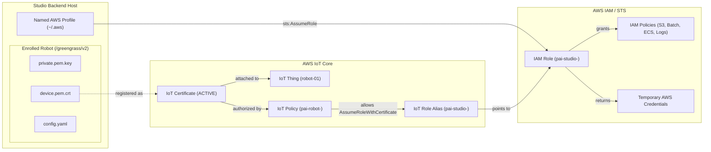

# AWS IoT Greengrass Robot Provisioning & Credential Exchange Plan

This plan covers how robots are enrolled with AWS IoT Core, how per-robot X.509 certificates are exchanged for temporary AWS credentials, how stack resources are deterministically derived from a single `StackId`, and how Physical AI Studio supports both AWS named profiles and IoT certificate exchange polymorphically.

## 1. Architecture Overview

- **Single-hop role model (`StudioRole`):** Both human operators (via named AWS profiles + `sts:AssumeRole`) and enrolled robots (via IoT Core `AssumeRoleWithCertificate` through `StudioRoleAlias`) assume the same least-privilege `StudioRole` directly—avoiding STS role chaining.
- **Fleet-level resources (shared per stack):** One `StudioRole` (`AWS::IAM::Role`), one `StudioRoleAlias` (`AWS::IoT::RoleAlias`), and one `RobotIoTPolicy` (`AWS::IoT::Policy`) per deployed stack.
- **Per-robot resources (isolated):** One IoT `Thing` and one unique X.509 certificate per robot.
- **Revocation:** Deactivating a robot's certificate (`INACTIVE` / `REVOKED`) in AWS IoT Core immediately blocks that robot from MQTT and from exchanging its certificate for temporary STS credentials.



---

## 2. `StackId` & Resource Naming Convention

Every CloudFormation deployment outputs a single 34-character composite `StackId` that uniquely identifies the stack across parallel deployments, regions, and accounts:

```text
<account_id>-<region>-<stack_uid>
# Example: 123456789012-eu-central-1-f4a9b2c0
```

- `account_id`: 12-digit AWS account ID (`!Ref AWS::AccountId`)
- `region`: AWS region (`!Ref AWS::Region`, e.g. `us-east-1`, `us-west-2`, `eu-central-1`)
- `stack_uid`: 8-character hex prefix of the CloudFormation stack UUID (`!Select [0, !Split ["-", !Select [2, !Split ["/", !Ref AWS::StackId]]]]`)

### CloudFormation Output Expression

```yaml
Outputs:
  StackId:
    Description: Composite stack identifier for Physical AI Studio and robot enrollment.
    Value: !Sub
      - "${AWS::AccountId}-${AWS::Region}-${StackUid}"
      - StackUid: !Select [0, !Split ["-", !Select [2, !Split ["/", !Ref AWS::StackId]]]]
```

### Parsing Pattern

```regex
^(?P<account_id>\d{12})-(?P<region>[a-z]{2,}(?:-[a-z]+)+-\d)-(?P<uid>[0-9a-f]{8})$
```

### Derived Resource Names & ARNs

From `StackId` (`<account_id>-<region>-<stack_uid>`), both Studio and `enroll-robot.sh` split out `account_id`, `region`, and `stack_uid`:
- Physical resource names use only `${stack_uid}` (e.g. `pai-jobs-f4a9b2c0`).
- Full ARNs combine `${account_id}`, `${region}`, and the `${stack_uid}` resource name (eliminating `studio-config.json` in S3):

| Resource | CFN Logical ID | Physical Name Convention | Length | Derived ARN / Identifier |
|---|---|---|---|---|
| **S3 Jobs Bucket** | `JobsBucket` | `pai-jobs-${stack_uid}` | 17 / 63 | `arn:aws:s3:::pai-jobs-${stack_uid}` |
| **Studio IAM Role** | `StudioRole` | `pai-studio-${stack_uid}` | 19 / 64 | `arn:aws:iam::${account_id}:role/pai-studio-${stack_uid}` |
| **IoT Role Alias** | `StudioRoleAlias` | `pai-studio-${stack_uid}` | 19 / 128 | `arn:aws:iot:${region}:${account_id}:rolealias/pai-studio-${stack_uid}` |
| **IoT Policy** | `RobotIoTPolicy` | `pai-robot-${stack_uid}` | 18 / 128 | `arn:aws:iot:${region}:${account_id}:policy/pai-robot-${stack_uid}` |
| **Trainer Log Group** | `TrainerLogGroup` | `/pai/trainer/${stack_uid}` | 21 / 512 | `arn:aws:logs:${region}:${account_id}:log-group:/pai/trainer/${stack_uid}` |
| **G4dn Job Queue** (`g4dn.2xlarge`) | `G4dnJobQueue` | `pai-g4dn-${stack_uid}` | 17 / 128 | `arn:aws:batch:${region}:${account_id}:job-queue/pai-g4dn-${stack_uid}` |
| **G4dn Job Definition** (`g4dn.2xlarge`) | `G4dnJobDefinition` | `pai-g4dn-${stack_uid}` | 17 / 128 | `arn:aws:batch:${region}:${account_id}:job-definition/pai-g4dn-${stack_uid}` |
| **G6e Job Queue** (`g6e.2xlarge`) | `G6eJobQueue` | `pai-g6e-${stack_uid}` | 16 / 128 | `arn:aws:batch:${region}:${account_id}:job-queue/pai-g6e-${stack_uid}` |
| **G6e Job Definition** (`g6e.2xlarge`) | `G6eJobDefinition` | `pai-g6e-${stack_uid}` | 16 / 128 | `arn:aws:batch:${region}:${account_id}:job-definition/pai-g6e-${stack_uid}` |
| **G7e Job Queue** (`g7e.8xlarge`) | `G7eJobQueue` | `pai-g7e-${stack_uid}` | 16 / 128 | `arn:aws:batch:${region}:${account_id}:job-queue/pai-g7e-${stack_uid}` |
| **G7e Job Definition** (`g7e.8xlarge`) | `G7eJobDefinition` | `pai-g7e-${stack_uid}` | 16 / 128 | `arn:aws:batch:${region}:${account_id}:job-definition/pai-g7e-${stack_uid}` |

---

## 3. Implementation Plan

### Step 1: CloudFormation Template (`application/cloudformation/aws-batch-trainer.yaml`)

1. **Deterministic Physical Resource Names**
   - Assign explicit physical names matching the `pai-*-${stack_uid}` table above.
2. **`StudioRole` (`AWS::IAM::Role`) & Policies**
   - **Trust policy:** Allows both `arn:${AWS::Partition}:iam::${AWS::AccountId}:root` (for IAM/SSO profile users) and `credentials.iot.amazonaws.com` (for IoT Role Alias credential exchange) to call `sts:AssumeRole`.
   - **Permissions policy:** Grants S3 (`jobs/*`, `validation/*`), Batch (`Describe*`, `SubmitJob`, `TerminateJob`), ECS (`DescribeTasks`), and CloudWatch Logs (`GetLogEvents`) access.
3. **`StudioRoleAlias` (`AWS::IoT::RoleAlias`)**
   - Named `pai-studio-${stack_uid}`, pointing directly to `StudioRole.Arn` (`CredentialDurationSeconds: 3600`).
4. **`RobotIoTPolicy` (`AWS::IoT::Policy`)**
   - Named `pai-robot-${stack_uid}`.
   - Grants `iot:Connect`, `iot:Publish`, `iot:Subscribe`, `iot:Receive`, `greengrass:*`, and `iot:AssumeRoleWithCertificate` on `StudioRoleAlias.Arn`.
5. **Stack Outputs**
   - Export `StackId` (`<account_id>-<region>-<stack_uid>`).

---

### Step 2: Per-Robot Enrollment Script (`enroll-robot.sh`)

Implement a shell script that runs once per robot—either from an admin machine (pre-staging) or directly on the robot—using AWS CLI credentials and `<StackId>` + `<robot-id>`:

1. **Derive Fleet Configuration from `StackId`**
   - Parses `account_id`, `region`, and `stack_uid` from `StackId`.
   - Infers `iotRoleAlias="pai-studio-${stack_uid}"` and `iotPolicy="pai-robot-${stack_uid}"`.
   - Resolves account IoT endpoints via `aws iot describe-endpoint --region "$region" --endpoint-type iot:Data-ATS` and `iot:CredentialProvider`.
2. **Create Robot Identity**
   - Creates the IoT `Thing` (`aws iot create-thing --thing-name <robot-id>`) and optionally adds it to a `ThingGroup`.
3. **Generate Keypair & Certificate**
   - Calls `aws iot create-keys-and-certificate --set-as-active` to produce:
     - `device.pem.crt` (device certificate)
     - `private.pem.key` (private key)
     - `AmazonRootCA1.pem` (downloaded from Amazon Trust Services)
     - `certificateId` (64-char hex ID registered in AWS IoT Core as `ACTIVE`)
4. **Bind Policy and Thing to Certificate**
   - `aws iot attach-policy --policy-name "pai-robot-${stack_uid}" --target <certificateArn>`
   - `aws iot attach-thing-principal --thing-name <robot-id> --principal <certificateArn>`
5. **Emit the Robot Bundle**
   - Writes `device.pem.crt`, `private.pem.key`, `AmazonRootCA1.pem`, and a rendered Greengrass `config.yaml` into an output directory ready to copy to `/greengrass/v2/` on the robot:

```yaml
system:
  certificateFilePath: "/greengrass/v2/device.pem.crt"
  privateKeyPath: "/greengrass/v2/private.pem.key"
  rootCaPath: "/greengrass/v2/AmazonRootCA1.pem"
  thingName: "<robot-id>"
services:
  aws.greengrass.Nucleus:
    configuration:
      awsRegion: "<region>"
      iotRoleAlias: "pai-studio-<stack_uid>"
      iotDataEndpoint: "<prefix>-ats.iot.<region>.amazonaws.com"
      iotCredEndpoint: "<prefix>.credentials.iot.<region>.amazonaws.com"
```

6. **Greengrass Installation on the Robot**
   - Copy the bundle to `/greengrass/v2/` on the robot and run the Greengrass Nucleus installer with `--provision false` (no operator IAM credentials needed on the robot).

---

### Step 3: Polymorphic Studio Credential Exchange (`services/aws_auth/`)

Support both **AWS Named Profiles** and **IoT X.509 Certificate Exchange** behind a single `AwsCredentialProvider` strategy interface:

#### 1. Discriminated Union Schema (`schemas/aws_auth.py`)

```python
class AwsAuthMode(StrEnum):
    PROFILE = "profile"
    IOT_CERTIFICATE = "iot_certificate"

class AwsProfileAuth(BaseModel):
    model_config = ConfigDict(str_strip_whitespace=True, extra="forbid")
    auth_mode: Literal[AwsAuthMode.PROFILE] = AwsAuthMode.PROFILE
    profile_name: AwsProfileName

class AwsIotCertificateAuth(BaseModel):
    model_config = ConfigDict(str_strip_whitespace=True, extra="forbid")
    auth_mode: Literal[AwsAuthMode.IOT_CERTIFICATE] = AwsAuthMode.IOT_CERTIFICATE

AwsAuthSelection = Annotated[
    AwsProfileAuth | AwsIotCertificateAuth,
    Field(discriminator="auth_mode"),
]
```

#### 2. `AwsCredentialProvider` Strategy Contract (`services/aws_auth/base.py`)

```python
class AwsCredentialProvider(ABC):
    @property
    @abstractmethod
    def issue_key(self) -> str:
        """Stable identifier for OperationalIssue UUID5 deduplication."""

    @abstractmethod
    def create_session(
        self,
        *,
        region: str | None = None,
        role_arn: str | None = None,
    ) -> boto3.Session:
        """Return an authenticated boto3.Session."""

    @abstractmethod
    def diagnose_error(self, error: Exception) -> AwsAuthenticationIssue | None:
        """Map provider-specific auth errors to actionable recovery."""
```

- **`ProfileCredentialProvider`:**
  - `create_session(region, role_arn)`: Opens `boto3.Session(profile_name=...)`. When `role_arn` is supplied, calls `sts.assume_role(RoleArn=role_arn, RoleSessionName="physicalai-studio")` to scope down to `StudioRole`.
  - `diagnose_error(error)`: Translates `ProfileNotFound`, `NoCredentialsError`, `SSOTokenLoadError`, and `ExpiredToken` into profile recovery instructions (including `aws sso login --profile=...`).
- **IoTCertificateCredentialProvider:**
  - Reads `/greengrass/v2/config.yaml` (configurable via `GREENGRASS_CONFIG_PATH`).
  - `create_session(region, role_arn)`: Performs an mTLS `GET` using `device.pem.crt`, `private.pem.key`, and `AmazonRootCA1.pem`:
    ```text
    GET https://<iotCredEndpoint>/role-aliases/pai-studio-<stack_uid>/credentials
    x-amzn-iot-thingname: <robot-id>
    ```
    Because `pai-studio-<stack_uid>` already resolves to `StudioRole`, it returns a `boto3.Session` with the returned STS credentials directly (no second `sts:AssumeRole` hop).
  - `diagnose_error(error)`: Translates missing certificate/config files, mTLS handshake failures, and HTTP `401`/`403` responses (e.g. `INACTIVE`/`REVOKED` certificate) into robot-enrollment recovery issues.

---

## 4. Managing & Revoking Robot Certificates

### AWS Console Locations

- **All certificates:** **AWS IoT → Security → Certificates**
- **Single robot's certificate:** **AWS IoT → Manage → All devices → Things → `<robot-id>` → Certificates**
- **IoT Policies:** **AWS IoT → Security → Policies** (`pai-robot-<stack_uid>`)
- **Role Aliases:** **AWS IoT → Security → Role aliases** (`pai-studio-<stack_uid>`)
- **Greengrass Core Devices:** **AWS IoT → Greengrass devices → Core devices**

### AWS CLI Commands

Find the certificate attached to a specific robot:

```bash
aws iot list-thing-principals --thing-name <ROBOT_THING_NAME>
```

Disable a compromised robot's certificate immediately (using the 64-character certificate ID from the ARN):

```bash
aws iot update-certificate \
  --certificate-id <CERTIFICATE_ID> \
  --new-status INACTIVE
```

---

## 5. Incident Response Controls

| Scenario | Where to Act | Action | Blast Radius |
|---|---|---|---|
| **Single robot stolen / tampered** | IoT Core → Certificates | Set robot's `certificateId` to `INACTIVE` or `REVOKED` | Only that robot loses MQTT and STS credential exchange |
| **Single robot should stop receiving deployments** | IoT Core → Thing Groups | Remove `<robot-id>` from the Thing Group | Only that robot stops receiving fleet updates |
| **Revoke S3/Batch permissions across stack** | IAM → Roles → `pai-studio-<stack_uid>` | Update the IAM policy on `StudioRole` | All operators and robots using that stack |
| **Block all robots from exchanging certs for STS tokens** | IoT Core → Policies → `pai-robot-<stack_uid>` | Remove `iot:AssumeRoleWithCertificate` statement | All robots enrolled in that stack (human IAM profiles unaffected) |


now please check the updated cloudformation template, we need to add auth provider to enable authenticating with a robot certificate. please consider that the certificate is located at a standard path on the filesystem


status update:

- **AWS side:** Remote training stack now supports IOT core and robot authentication flow.  
- **Robot side:** a shell script that enrolls a robot in IoT Core.
- **Robot/Studio side** Studio now supports IOT core and robot authentication flow.  

Plans for tomorrow:

- Create a readme how to enroll a robot.
- Create a script that installs nucleus from snap and copies certificates bundle 
- Record a demo