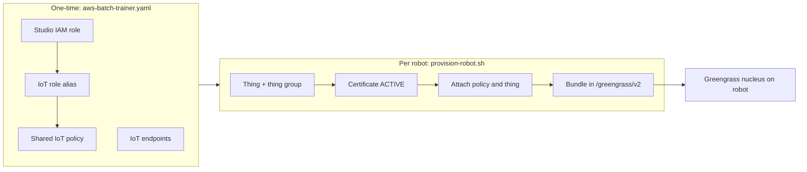

# Robot Fleet Provisioning with AWS IoT Greengrass

Robots run the [AWS IoT Greengrass V2](https://docs.aws.amazon.com/greengrass/v2/developerguide/what-is-iot-greengrass.html) nucleus to receive software deployments and exchange their device certificate for temporary AWS credentials. Provisioning is split into a one-time account setup and a per-robot step run from an administrator machine.



At runtime, the robot connects to the IoT data endpoint over MQTT with its certificate and calls the credentials endpoint with the role alias to obtain short-lived credentials for the Studio role.

## Prerequisites

On the **administrator machine**:

- AWS CLI v2 authenticated with permission to manage CloudFormation, IAM, IoT, and Lambda;
- `curl`, and `ssh`/`scp` if delivering bundles over SSH.

On each **robot**:

- Linux with `systemd` and a Java runtime (Java 11 or later);
- outbound HTTPS (443) and MQTT over TLS (8883) to AWS IoT endpoints;
- an SSH user with `sudo` if bundles are delivered over SSH.

## Deploy the shared stack

The Greengrass entities are part of the AWS Batch trainer stack, [`aws-batch-trainer.yaml`](../cloudformation/aws-batch-trainer.yaml), so a single stack serves both remote training and the robot fleet. If you already deployed it from [Remote Training](./07-remote-training.md#aws-batch-provider), update it to the current template. Otherwise deploy it once per account and region:

```bash
aws cloudformation deploy \
  --template-file application/cloudformation/aws-batch-trainer.yaml \
  --stack-name physical-ai-studio-batch-trainer \
  --region us-east-1 \
  --capabilities CAPABILITY_NAMED_IAM
```

`CAPABILITY_NAMED_IAM` is required because the Studio IAM role has an explicit name. In the AWS Console, confirm the corresponding acknowledgement checkbox.

`<stack-uuid>` is the first 8 characters of the UUID CloudFormation generates for the stack, the last segment of the stack ID (`arn:aws:cloudformation:<region>:<account-id>:stack/<stack-name>/6ba57d60-dddb-11f1-92b4-0affcf8b7305` gives `6ba57d60`). Every named resource ends with it, so the jobs bucket is `pai-jobs-6ba57d60`. The stack identifier `<account-id>-<region>-<stack-uuid>` is published as the `StackIdentifier` output.

| Robot fleet parameter            | Default | Description                                                         |
| -------------------------------- | ------- | ------------------------------------------------------------------- |
| `RobotArtifactBucketName`        | empty   | Additional S3 bucket robots can read and write. Empty grants none.  |
| `RobotCredentialDurationSeconds` | `3600`  | Lifetime of credentials vended through the role alias (900–43200).  |

| Resource            | Logical ID          | Name                         | ARN                                                                 |
| ------------------- | ------------------- | ---------------------------- | ------------------------------------------------------------------- |
| S3 jobs bucket      | `JobsBucket`        | `pai-jobs-<stack-uuid>`      | `arn:aws:s3:::pai-jobs-<stack-uuid>`                                |
| Studio IAM role     | `StudioRole`        | `pai-studio-<stack-uuid>`    | `arn:aws:iam::<account-id>:role/pai-studio-<stack-uuid>`            |
| IoT role alias      | `StudioRoleAlias`   | `pai-studio-<stack-uuid>`    | `arn:aws:iot:<region>:<account-id>:rolealias/pai-studio-<stack-uuid>` |
| IoT policy          | `RobotIoTPolicy`    | `pai-robot-<stack-uuid>`     | `arn:aws:iot:<region>:<account-id>:policy/pai-robot-<stack-uuid>`   |
| Trainer log group   | `TrainerLogGroup`   | `/pai/trainer/<stack-uuid>`  | `arn:aws:logs:<region>:<account-id>:log-group:/pai/trainer/<stack-uuid>` |
| g4dn job queue      | `G4dnJobQueue`      | `pai-g4dn-<stack-uuid>`      | `arn:aws:batch:<region>:<account-id>:job-queue/pai-g4dn-<stack-uuid>` |
| g4dn job definition | `G4dnJobDefinition` | `pai-g4dn-<stack-uuid>`      | `arn:aws:batch:<region>:<account-id>:job-definition/pai-g4dn-<stack-uuid>` |
| g6e job queue       | `G6eJobQueue`       | `pai-g6e-<stack-uuid>`       | `arn:aws:batch:<region>:<account-id>:job-queue/pai-g6e-<stack-uuid>` |
| g6e job definition  | `G6eJobDefinition`  | `pai-g6e-<stack-uuid>`       | `arn:aws:batch:<region>:<account-id>:job-definition/pai-g6e-<stack-uuid>` |
| g7e job queue       | `G7eJobQueue`       | `pai-g7e-<stack-uuid>`       | `arn:aws:batch:<region>:<account-id>:job-queue/pai-g7e-<stack-uuid>` |
| g7e job definition  | `G7eJobDefinition`  | `pai-g7e-<stack-uuid>`       | `arn:aws:batch:<region>:<account-id>:job-definition/pai-g7e-<stack-uuid>` |

Networking and Batch support resources use generated names.

- **Studio role**: used by the Studio backend and, through the role alias, by robots. It trusts the account and `credentials.iot.amazonaws.com`, and in addition to Studio job permissions grants CloudWatch Logs under `/aws/greengrass/*`, ECR image pulls in the account, and optional S3 access to `RobotArtifactBucketName`.
- **Role alias**: bridges the IoT credential provider to the Studio role and caps session duration. To restrict the whole fleet in an emergency, point the alias at a more restricted role.
- **Robot IoT policy**: allows `iot:Connect` only with a client ID starting with the robot's thing name, MQTT publish/subscribe/receive, `greengrass:*`, and `iot:AssumeRoleWithCertificate` on the role alias only.

The stack has two outputs:

| Output             | Used as                                                                    |
| ------------------ | -------------------------------------------------------------------------- |
| `ConfigurationUri` | S3 configuration URI for the Studio AWS Batch training target.             |
| `StackIdentifier`  | `<account-id>-<region>-<stack-uuid>`; every name and ARN above derives from it. |

The account IoT endpoints are not stack resources; read them with `aws iot describe-endpoint --endpoint-type iot:Data-ATS` and `--endpoint-type iot:CredentialProvider`. The provisioning script does this automatically.

To change robot permissions, edit the `StudioRole` policies in the template and update the stack. Changes apply to the fleet when robots next refresh credentials.

### Robot permissions

Robots receive Studio role credentials directly from the credentials endpoint; components that depend on `aws.greengrass.TokenExchangeService` get them through the container credentials endpoint with no extra configuration. Every provisioned robot therefore has the Studio role's permissions, including read and write access to the `jobs/` and `validation/` prefixes of the jobs bucket and AWS Batch job submission.

## Prepare the robot

Find the nucleus version you will install; the provisioning script writes it into `config.yaml`, and it must match. On the robot:

```bash
curl -s https://d2s8p88vqu9w66.cloudfront.net/releases/greengrass-nucleus-latest.zip -o greengrass-nucleus.zip
unzip greengrass-nucleus.zip -d GreengrassInstaller
java -jar ./GreengrassInstaller/lib/Greengrass.jar --version
```

Create the default component user and group:

```bash
sudo useradd --system --create-home ggc_user
sudo groupadd --system ggc_group
```

## Provision a robot

Run [`provision-robot.sh`](../cloudformation/provision-robot.sh) on the administrator machine:

```bash
application/cloudformation/provision-robot.sh \
  --thing-name robot-01 \
  --thing-group warehouse-robots \
  --stack-identifier 123456789012-us-east-1-6ba57d60 \
  --nucleus-version 2.15.0 \
  --ssh admin@robot-01.local
```

Without `--stack-identifier`, the script reads the `StackIdentifier` output from `--stack` in `--region`. It derives the region, role alias (`pai-studio-<stack-uuid>`), and IoT policy (`pai-robot-<stack-uuid>`) from the identifier, checks that both exist and that the current AWS credentials belong to the identifier's account, and reads the IoT endpoints from the IoT API.

| Option               | Default                            | Description                                                      |
| -------------------- | ---------------------------------- | ---------------------------------------------------------------- |
| `--thing-name`       | required                           | IoT thing name; also the MQTT client ID prefix.                  |
| `--thing-group`      | none                               | Thing group to join; created if missing.                         |
| `--stack-identifier` | none                               | `StackIdentifier` stack output; skips the CloudFormation lookup. |
| `--stack`            | `physical-ai-studio-batch-trainer` | Stack to read `StackIdentifier` from.                            |
| `--region`           | AWS CLI region                     | Region of `--stack`; ignored with `--stack-identifier`.          |
| `--csr`             | none                            | Sign a CSR instead of generating a key pair (see below).        |
| `--nucleus-version` | `2.15.0`                        | Nucleus version installed on the robot.                         |
| `--output-dir`      | `./robot-bundles/<thing-name>`  | Local bundle directory.                                         |
| `--ssh`             | none                            | `user@host` to install the bundle into `/greengrass/v2`.        |

The script:

1. Creates the thing, or reuses an existing one, and adds it to the thing group.
2. Creates an `ACTIVE` certificate and downloads `AmazonRootCA1.pem`.
3. Attaches the shared IoT policy and the thing to the certificate.
4. Renders `config.yaml` and, with `--ssh`, installs the bundle into `/greengrass/v2` (private key mode `600`, other files `644`).

It prints the thing ARN, certificate ID, and the command to deactivate the certificate. Every run creates a new certificate; the script refuses to overwrite an existing bundle directory.

| Bundle file         | Purpose                                                    |
| ------------------- | ---------------------------------------------------------- |
| `device.pem.crt`    | Robot client certificate.                                  |
| `private.pem.key`   | Robot private key (omitted with `--csr`).                  |
| `AmazonRootCA1.pem` | AWS root CA for verifying IoT endpoints.                   |
| `config.yaml`       | Nucleus configuration with thing name, region, and endpoints. |

> [!WARNING]
> Without `--csr`, a copy of the private key remains in the local bundle directory. Delete it after confirming delivery, or store it in a secrets manager if it must be kept.

Without `--ssh`, copy the bundle files to `/greengrass/v2/` on the robot yourself, with the same permissions.

### Keep the private key on the robot

To generate the key on the robot so it never leaves the device, create the key and a CSR on the robot:

```bash
sudo install -d -m 755 /greengrass/v2
sudo openssl ecparam -name prime256v1 -genkey -noout -out /greengrass/v2/private.pem.key
sudo chmod 600 /greengrass/v2/private.pem.key
sudo openssl req -new -key /greengrass/v2/private.pem.key -subj "/CN=robot-01" -out robot-01.csr
```

Copy `robot-01.csr` to the administrator machine and pass `--csr robot-01.csr` to the script. The bundle then contains only the certificate, root CA, and configuration. Keys held in a TPM or HSM require the Greengrass PKCS#11 provider and a `privateKeyPath` pointing at the PKCS#11 URI; adjust `config.yaml` accordingly.

## Verify the robot credentials

Before installing Greengrass, you can confirm that the certificate, IoT policy, and role alias work together by requesting credentials directly from the credentials endpoint. Run this from the bundle directory; `iotRoleAlias` and `iotCredEndpoint` are in its `config.yaml`:

```bash
curl --cert device.pem.crt --key private.pem.key --cacert AmazonRootCA1.pem \
  -H "x-amzn-iot-thingname: robot-01" \
  "https://<iotCredEndpoint>/role-aliases/pai-studio-<stack-uuid>/credentials"
```

A JSON response with `accessKeyId`, `secretAccessKey`, `sessionToken`, and `expiration` confirms the chain. The response contains live credentials; do not log or share it. If the certificate is inactive or revoked, the TLS handshake fails and `curl` returns no HTTP status.

## Start Greengrass on the robot

Install the nucleus as a system service using the delivered configuration:

```bash
sudo -E java -Droot="/greengrass/v2" -Dlog.store=FILE \
  -jar ./GreengrassInstaller/lib/Greengrass.jar \
  --init-config /greengrass/v2/config.yaml \
  --component-default-user ggc_user:ggc_group \
  --setup-system-service true
```

Verify from the administrator machine that the core device reports `HEALTHY`:

```bash
aws greengrassv2 get-core-device --core-device-thing-name robot-01 --region us-east-1
```

On the robot, logs are in `/greengrass/v2/logs/greengrass.log`.

## Deploy software to robots

Target deployments at the thing group so every provisioned robot in it receives the same components:

```bash
aws greengrassv2 create-deployment \
  --target-arn arn:aws:iot:us-east-1:<account-id>:thinggroup/warehouse-robots \
  --components '{"aws.greengrass.Cli": {"componentVersion": "2.15.0"}}' \
  --region us-east-1
```

Robots added to the group later receive the group's latest deployment automatically. Components pulling artifacts from S3 or images from ECR use the Studio role permissions.

## Revoke or decommission a robot

Each certificate is a per-robot kill switch. Deactivating it immediately blocks MQTT connections and credential exchange for that robot:

```bash
aws iot update-certificate --certificate-id <certificate-id> --new-status INACTIVE
```

Use `REVOKED` instead of `INACTIVE` for a compromised key; revoked certificates cannot be reactivated. Existing temporary credentials remain valid until they expire, up to `CredentialDurationSeconds`.

To remove a robot completely:

```bash
CERT_ARN=arn:aws:iot:us-east-1:<account-id>:cert/<certificate-id>
aws iot detach-thing-principal --thing-name robot-01 --principal "$CERT_ARN"
aws iot detach-policy --policy-name pai-robot-<stack-uuid> --target "$CERT_ARN"
aws iot update-certificate --certificate-id <certificate-id> --new-status INACTIVE
aws iot delete-certificate --certificate-id <certificate-id>
aws greengrassv2 delete-core-device --core-device-thing-name robot-01
aws iot delete-thing --thing-name robot-01
```

To rotate a robot's certificate, run the script again with a new `--output-dir`, deliver the bundle, restart Greengrass (`sudo systemctl restart greengrass`), then deactivate the old certificate.

## Remove the shared stack

Decommission all robots first; delete the stack only when no robot certificates reference the IoT policy, because CloudFormation cannot delete a policy that is still attached. Deleting the stack also removes the AWS Batch training resources and job data:

```bash
aws cloudformation delete-stack --stack-name physical-ai-studio-batch-trainer --region us-east-1
```
