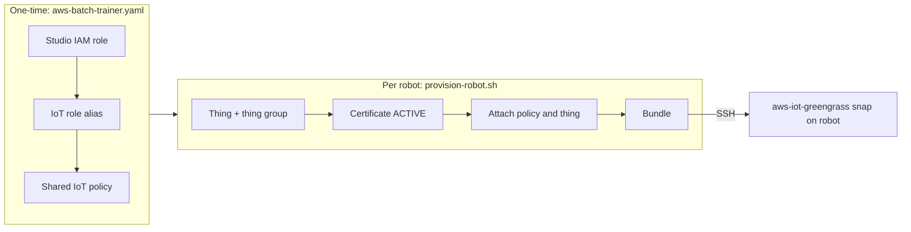

# Robot Fleet Provisioning with AWS IoT Greengrass

Robots run the [AWS IoT Greengrass V2](https://docs.aws.amazon.com/greengrass/v2/developerguide/what-is-iot-greengrass.html) nucleus from the `aws-iot-greengrass` snap to receive software deployments and exchange their device certificate for temporary AWS credentials. Provisioning is split into a one-time account setup and a per-robot step run from an administrator machine.



At runtime, the robot connects to the IoT data endpoint over MQTT with its certificate and calls the credentials endpoint with the role alias to obtain short-lived credentials for the Studio role.

## Prerequisites

On the **administrator machine**:

- AWS CLI v2 authenticated with permission to manage CloudFormation, IAM, IoT, and Lambda;
- `curl`, and `ssh`/`scp` for delivering bundles to robots.

On each **robot**:

- Ubuntu (or another Linux distribution) with `snapd`;
- outbound HTTPS (443) and MQTT over TLS (8883) to AWS IoT endpoints;
- an SSH user with `sudo`.

## Deploy the shared stack

The Greengrass entities are part of the AWS Batch trainer stack, [`aws-batch-trainer.yaml`](../cloudformation/aws-batch-trainer.yaml), so a single stack serves both remote training and the robot fleet. If you already deployed it from [Remote Training](./07-remote-training.md#aws-batch-provider), update it to the current template. Otherwise deploy it once per account and region:

```bash
aws cloudformation deploy \
  --template-file application/cloudformation/aws-batch-trainer.yaml \
  --stack-name physical-ai-studio-batch-trainer \
  --region us-east-1 \
  --capabilities CAPABILITY_NAMED_IAM
```

`CAPABILITY_NAMED_IAM` is required because the Studio IAM role has an explicit name. In the AWS Console, confirm the corresponding acknowledgement checkbox.

`<stack-uuid>` is the first 8 characters of the UUID CloudFormation generates for the stack, the last segment of the stack ID (`arn:aws:cloudformation:<region>:<account-id>:stack/<stack-name>/6ba57d60-dddb-11f1-92b4-0affcf8b7305` gives `6ba57d60`). Every named resource ends with it, so the jobs bucket is `pai-jobs-6ba57d60`. The stack identifier `<account-id>-<region>-<stack-uuid>` is published as the `StackIdentifier` output.

| Robot fleet parameter            | Default | Description                                                         |
| -------------------------------- | ------- | ------------------------------------------------------------------- |
| `RobotArtifactBucketName`        | empty   | Additional S3 bucket robots can read and write. Empty grants none.  |
| `RobotCredentialDurationSeconds` | `3600`  | Lifetime of credentials vended through the role alias (900–43200).  |

| Resource            | Logical ID          | Name                         | ARN                                                                 |
| ------------------- | ------------------- | ---------------------------- | ------------------------------------------------------------------- |
| S3 jobs bucket      | `JobsBucket`        | `pai-jobs-<stack-uuid>`      | `arn:aws:s3:::pai-jobs-<stack-uuid>`                                |
| Studio IAM role     | `StudioRole`        | `pai-studio-<stack-uuid>`    | `arn:aws:iam::<account-id>:role/pai-studio-<stack-uuid>`            |
| IoT role alias      | `StudioRoleAlias`   | `pai-studio-<stack-uuid>`    | `arn:aws:iot:<region>:<account-id>:rolealias/pai-studio-<stack-uuid>` |
| IoT policy          | `RobotIoTPolicy`    | `pai-robot-<stack-uuid>`     | `arn:aws:iot:<region>:<account-id>:policy/pai-robot-<stack-uuid>`   |
| Trainer log group   | `TrainerLogGroup`   | `/pai/trainer/<stack-uuid>`  | `arn:aws:logs:<region>:<account-id>:log-group:/pai/trainer/<stack-uuid>` |
| g4dn job queue      | `G4dnJobQueue`      | `pai-g4dn-<stack-uuid>`      | `arn:aws:batch:<region>:<account-id>:job-queue/pai-g4dn-<stack-uuid>` |
| g4dn job definition | `G4dnJobDefinition` | `pai-g4dn-<stack-uuid>`      | `arn:aws:batch:<region>:<account-id>:job-definition/pai-g4dn-<stack-uuid>` |
| g6e job queue       | `G6eJobQueue`       | `pai-g6e-<stack-uuid>`       | `arn:aws:batch:<region>:<account-id>:job-queue/pai-g6e-<stack-uuid>` |
| g6e job definition  | `G6eJobDefinition`  | `pai-g6e-<stack-uuid>`       | `arn:aws:batch:<region>:<account-id>:job-definition/pai-g6e-<stack-uuid>` |
| g7e job queue       | `G7eJobQueue`       | `pai-g7e-<stack-uuid>`       | `arn:aws:batch:<region>:<account-id>:job-queue/pai-g7e-<stack-uuid>` |
| g7e job definition  | `G7eJobDefinition`  | `pai-g7e-<stack-uuid>`       | `arn:aws:batch:<region>:<account-id>:job-definition/pai-g7e-<stack-uuid>` |

Networking and Batch support resources use generated names.

- **Studio role**: used by the Studio backend and, through the role alias, by robots. It trusts the account and `credentials.iot.amazonaws.com`, and in addition to Studio job permissions grants CloudWatch Logs under `/aws/greengrass/*`, ECR image pulls in the account, and optional S3 access to `RobotArtifactBucketName`.
- **Role alias**: bridges the IoT credential provider to the Studio role and caps session duration. To restrict the whole fleet in an emergency, point the alias at a more restricted role.
- **Robot IoT policy**: allows `iot:Connect` only with a client ID starting with the robot's thing name, MQTT publish/subscribe/receive, `greengrass:*`, and `iot:AssumeRoleWithCertificate` on the role alias only.

The stack has one output, `StackIdentifier` (`<account-id>-<region>-<stack-uuid>`); every name and ARN above derives from it, and the robot scripts take it as `--stack-identifier`:

```bash
aws cloudformation describe-stacks --stack-name physical-ai-studio-batch-trainer --region us-east-1 \
  --query "Stacks[0].Outputs[?OutputKey=='StackIdentifier'].OutputValue" --output text
```

The account IoT endpoints are not stack resources; the provisioning script reads them with `aws iot describe-endpoint`.

To change robot permissions, edit the `StudioRole` policies in the template and update the stack. Changes apply to the fleet when robots next refresh credentials.

### Robot permissions

Robots receive Studio role credentials directly from the credentials endpoint; components that depend on `aws.greengrass.TokenExchangeService` get them through the container credentials endpoint with no extra configuration. Every provisioned robot therefore has the Studio role's permissions, including read and write access to the `jobs/` and `validation/` prefixes of the jobs bucket and AWS Batch job submission.

## Provision a robot

Run [`provision-robot.sh`](../cloudformation/provision-robot.sh) on the administrator machine. With `--ssh`, it also installs Greengrass on the robot (see [Install Greengrass on the robot](#install-greengrass-on-the-robot)):

```bash
application/cloudformation/provision-robot.sh \
  --thing-name robot-01 \
  --stack-identifier 123456789012-us-east-1-6ba57d60 \
  --thing-group warehouse-robots \
  --ssh <user>@robot-01.local
```

The script derives the region, role alias (`pai-studio-<stack-uuid>`), and IoT policy (`pai-robot-<stack-uuid>`) from the stack identifier, checks that both exist and that the current AWS credentials belong to the identifier's account, and reads the IoT endpoints from the IoT API.

| Option               | Default                        | Description                                                         |
| -------------------- | ------------------------------ | ------------------------------------------------------------------- |
| `--thing-name`       | required                       | IoT thing name; also the MQTT client ID prefix.                     |
| `--stack-identifier` | required                       | `StackIdentifier` output of the shared stack.                       |
| `--thing-group`      | none                           | Thing group to join; created if missing.                            |
| `--output-dir`       | `./robot-bundles/<thing-name>` | Local bundle directory.                                             |
| `--ssh`              | none                           | `user@host` of the robot; delivers the bundle and installs Greengrass. |

The script:

1. Creates the thing, or reuses an existing one, and adds it to the thing group.
2. Creates an `ACTIVE` certificate and key pair and downloads `AmazonRootCA1.pem`.
3. Attaches the shared IoT policy and the thing to the certificate.
4. Writes the bundle and, with `--ssh`, delivers it to the robot.

It prints the thing ARN, certificate ID, and the command to deactivate the certificate. Every run creates a new certificate; the script refuses to overwrite an existing bundle directory.

| Bundle file                  | Purpose                                                                 |
| ---------------------------- | ----------------------------------------------------------------------- |
| `device.pem.crt`             | Robot client certificate.                                               |
| `private.pem.key`            | Robot private key.                                                      |
| `AmazonRootCA1.pem`          | AWS root CA for verifying IoT endpoints.                                |
| `config.yaml`                | Nucleus configuration with thing name, region, endpoints, and the snap's Greengrass root. |
| `install-greengrass-snap.sh` | Installer run on the robot.                                             |

> [!WARNING]
> A copy of the private key remains in the local bundle directory, which is git-ignored. Delete it after Greengrass is running, or store it in a secrets manager if it must be kept.

## Verify the robot credentials

Before installing Greengrass, you can confirm that the certificate, IoT policy, and role alias work together by requesting credentials directly from the credentials endpoint. Run this from the bundle directory; `iotRoleAlias` and `iotCredEndpoint` are in its `config.yaml`:

```bash
curl --cert device.pem.crt --key private.pem.key --cacert AmazonRootCA1.pem \
  -H "x-amzn-iot-thingname: robot-01" \
  "https://<iotCredEndpoint>/role-aliases/pai-studio-<stack-uuid>/credentials"
```

A JSON response with `accessKeyId`, `secretAccessKey`, `sessionToken`, and `expiration` confirms the chain. The response contains live credentials; do not log or share it. If the certificate is inactive or revoked, the TLS handshake fails and `curl` returns no HTTP status.

## Install Greengrass on the robot

Robots run Greengrass from the `aws-iot-greengrass` snap in the Snap Store. It bundles Java and the Greengrass V2 nucleus ([source](https://github.com/aws-greengrass/aws-greengrass-snap)) and runs Greengrass as the `aws-iot-greengrass.greengrass-daemon` service. Because the snap is strictly confined, its Greengrass root is `/var/snap/aws-iot-greengrass/common/greengrass/v2`.

> [!NOTE]
> Do not run `aws-iot-greengrass.configure` or `aws-iot-greengrass.bootstrap`. They create their own thing, certificate, and IoT policy and use the `GreengrassV2TokenExchangeRoleAlias` role alias, bypassing the stack's role alias and robot IoT policy.

`provision-robot.sh --ssh` runs [`deliver-robot-bundle.sh`](../cloudformation/deliver-robot-bundle.sh), which copies the bundle to a temporary directory on the robot over SSH, runs [`install-greengrass-snap.sh`](../cloudformation/install-greengrass-snap.sh) with `sudo`, and removes the temporary copy even if installation fails. The SSH user needs `sudo`; you may be prompted for its password.

To deliver an existing bundle later, or to retry after fixing the robot, run the delivery script on its own from the administrator machine:

```bash
application/cloudformation/deliver-robot-bundle.sh \
  --bundle application/cloudformation/robot-bundles/robot-01 \
  --ssh <user>@robot-01.local
```

Without SSH access, copy the bundle directory to the robot and run `sudo ./install-greengrass-snap.sh <bundle-dir>` there.

The installer:

1. Installs the `aws-iot-greengrass` snap if missing and checks that it provides Greengrass V2. Creates `/etc/ssl/certs/java` if missing, because the snap bind-mounts its Java trust store there and snapd cannot create that mount point itself.
2. Connects the snap's disconnected interfaces, except those that grant root-equivalent access to the robot (see below); interfaces without a provider on the robot are skipped.
3. Installs the bundle into the snap's Greengrass root (private key mode `600`, other files `644`) and sets the nucleus version in `config.yaml` to the snap's version.
4. Installs the nucleus from the snap into that root inside the snap's confinement, using the snap's Java runtime, without starting it.
5. Restarts `aws-iot-greengrass.greengrass-daemon`, which starts Greengrass from that root.

It refuses to run if Greengrass is already installed in the snap's root; run `sudo snap remove --purge aws-iot-greengrass` on the robot to start over. If the snap fails with `cannot update snap namespace: cannot write to /etc/ssl/certs/java`, create the directory and reset the snap's mount namespace, then run the installer again:

```bash
sudo mkdir -p /etc/ssl/certs/java
sudo /usr/lib/snapd/snap-discard-ns aws-iot-greengrass
```

Follow the logs on the robot:

```bash
sudo snap logs -f aws-iot-greengrass.greengrass-daemon
sudo tail -f /var/snap/aws-iot-greengrass/common/greengrass/v2/logs/greengrass.log
```

The service waits about 30 seconds after start before launching the nucleus. Components run as `root` inside the snap's confinement, limited by the snap's plugs.

#### Snap interfaces

Snap interfaces grant the confined snap access to resources outside its sandbox. Check what is connected with `snap connections aws-iot-greengrass`.

| Plug | Grants | Installer |
| --- | --- | --- |
| `network`, `network-bind` | Outbound connections and listening ports | Connected (usually automatic) |
| `home` | Users' home directories | Connected (usually automatic) |
| `system-observe`, `mount-observe`, `hardware-observe` | Read-only process, mount, and hardware information | Connected |
| `camera` | Camera devices | Connected |
| `snapd-control` | Installing and removing snaps | Not connected |
| `docker`, `docker-executables` | Docker daemon and CLI from the `docker` snap | Not connected |
| `process-control` | Signalling and reprioritizing any process | Not connected |

The last three rows grant root-equivalent control of the robot to every component deployed to it. Connect one only if a component needs it, for example `sudo snap connect aws-iot-greengrass:docker docker:docker-daemon` for Docker-based components, then restart the service with `sudo snap restart aws-iot-greengrass.greengrass-daemon`.

### Verify the core device

Verify from the administrator machine that the core device reports `HEALTHY`:

```bash
aws greengrassv2 get-core-device --core-device-thing-name robot-01 --region us-east-1
```

## Deploy software to robots

Target deployments at the thing group so every provisioned robot in it receives the same components:

```bash
aws greengrassv2 create-deployment \
  --target-arn arn:aws:iot:us-east-1:<account-id>:thinggroup/warehouse-robots \
  --components '{"aws.greengrass.Cli": {"componentVersion": "2.15.0"}}' \
  --region us-east-1
```

Robots added to the group later receive the group's latest deployment automatically. Components pulling artifacts from S3 or images from ECR use the Studio role permissions.

## Revoke or decommission a robot

Each certificate is a per-robot kill switch. Deactivating it immediately blocks MQTT connections and credential exchange for that robot:

```bash
aws iot update-certificate --certificate-id <certificate-id> --new-status INACTIVE
```

Use `REVOKED` instead of `INACTIVE` for a compromised key; revoked certificates cannot be reactivated. Existing temporary credentials remain valid until they expire, up to `RobotCredentialDurationSeconds`.

To remove a robot completely, run [`deprovision-robot.sh`](../cloudformation/deprovision-robot.sh) on the administrator machine. It takes the same `--stack-identifier` and `--ssh` options as the provisioning script and asks you to type the thing name to confirm (skip with `--yes`):

```bash
application/cloudformation/deprovision-robot.sh \
  --thing-name robot-01 \
  --stack-identifier 123456789012-us-east-1-6ba57d60 \
  --ssh <user>@robot-01.local
```

With `--ssh`, the script first removes Greengrass from the robot: it checks that the robot's Greengrass `config.yaml` belongs to the same thing (and stops without changes otherwise), runs `sudo snap remove --purge aws-iot-greengrass`, and removes `/etc/ssl/certs/java` if it is empty. Without `--ssh`, run `sudo snap remove --purge aws-iot-greengrass` on the robot yourself.

In AWS, for each certificate attached to the thing, the script detaches it, then deactivates it, detaches all IoT policies, and deletes it. A certificate still used by another thing is only detached from this robot. It then deletes the Greengrass core device record, if any, and the thing, which also removes it from its thing groups. Delete any local bundle copy on the administrator machine.

To rotate a robot's certificate, provision it again with a new `--output-dir` and without `--ssh`, run `sudo snap remove --purge aws-iot-greengrass` on the robot, deliver the new bundle with `deliver-robot-bundle.sh`, then deactivate the old certificate.

## Remove the shared stack

Decommission all robots first; delete the stack only when no robot certificates reference the IoT policy, because CloudFormation cannot delete a policy that is still attached. Deleting the stack also removes the AWS Batch training resources and job data:

```bash
aws cloudformation delete-stack --stack-name physical-ai-studio-batch-trainer --region us-east-1
```
