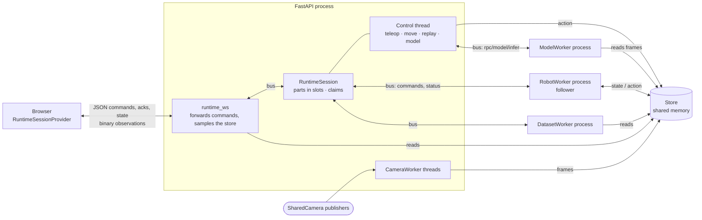

# Runtime Session Architecture

Studio drives a physical robot in a few ways: previewing it, teleoperating it by hand, recording a dataset, replaying an episode and running a trained policy. All of them run in one **runtime session**. The session belongs to a websocket, holds what that page has loaded (an environment, a dataset, a model) and runs one **control** that decides what the follower does.

This page covers the decisions and constraints you cannot read off the code, especially the traps. For what the code does, read `backend/src/runtime_session/` and `backend/src/workers/`. For how it was built and why in this order, see [the runtime inhousing plan](../feature_plans/runtime-inhousing-plan.md).

## Contents

- [Why Studio runs its own runtime](#why-studio-runs-its-own-runtime)
- [The shape](#the-shape)
- [The store](#the-store)
- [The bus](#the-bus)
- [Parts and slots](#parts-and-slots)
- [Controls](#controls)
- [Models](#models)
- [The socket](#the-socket)
- [Lifecycle](#lifecycle)
- [Exclusivity](#exclusivity)
- [Export](#export)
- [Traps](#traps)
- [Constraints](#constraints)

## Why Studio runs its own runtime

Studio used to run on `physicalai.runtime.RobotRuntime`: one loop at one fps, with Studio plugging in an action source and callbacks, in a detached process found again over zenoh. That is the right shape for running one policy on a robot, and it stays the deployment path (see [Export](#export)). It is the wrong shape for Studio, which needs:

- **Different rates at once.** The follower runs at 100 Hz, cameras at their own fps, a dataset records at 30 Hz and a model is asked for chunks when its queue runs low. One loop at one fps forces all of them onto the slowest.
- **Parts that come and go.** A page swaps the dataset or the model, or reloads the environment, while the session keeps running. The old runtime fixed its devices and callbacks at construction and had to be rebuilt around them.
- **Controls that can be anything.** Teleop, a move to a pose, a replay, a policy, and later a human in the loop. Each is a small class that can act on many things, not a mode inside one action source.

Studio still uses `physicalai` for everything below the loop: `physicalai.robot` drivers, `SharedCamera`, `InferenceModel`, and `physicalai.runtime`'s policy execution (`PolicySource`, the executors, `ChunkedActionQueue`, `LerpSmoother`), so a policy runs in Studio exactly as an export runs it.

## The shape

Two kinds of traffic, two channels:

- **Data** (joints and frames) goes through the **store**, a shared-memory block every process attaches to. Nothing samples-and-forwards it: each reader takes the latest value when it wants one.
- **Commands and status** go over the **bus**, a zenoh session private to this session.

What runs where follows from one rule: **anything that holds hardware or holds the GIL for long runs in its own process.** The follower's driver, lerobot's parquet and video writing, and model inference are processes. Cameras are threads, because `SharedCamera` already captures in a publisher process. Controls are threads in the API process, because they borrow things that cannot cross a process boundary (the connected leader driver, the loaded model's executor).

## The store

`runtime_session/store.py`. One block per session holds the latest `state` (measured joints), `action` (commanded joints) and one frame per camera, each with a timestamp.

- **No locking.** Readers copy a buffer out while the writer may be writing it, so a read can mix two consecutive samples. They are one tick apart and the world moves continuously, so a torn sample is still physically plausible. Aligned 8-byte stores are atomic on x86-64 and arm64, so a torn joint vector never holds half-written floats.
- **Write order matters.** Writers store the values first and the timestamp last, and readers read the timestamp first. NaN means "not written yet", so a reader never takes an unwritten feature's zeros for a reading.
- **Timestamps are `time.monotonic()`**, which is system-wide on Linux and comparable across processes. An action's timestamp is when it should happen, which is how a model's chunk reaches the robot as a `goal_time` (see [Controls](#controls)).
- **The spec is the session's shape.** `FeatureSpec` is one robot's joint names (namespaced the way a dataset stores them, `shoulder_pan.pos`) and the cameras by dataset key. A dataset's `observation.state`, `action` and `observation.images.<key>` compare to it directly. A dataset or model that needs something the spec lacks is refused with the differences listed.
- **The store outlives a reloaded environment** while its spec stays the same, so a dataset that is recording keeps recording across a reload.
- **Blocks are named `pai-<creator pid>-<session id>`.** A backend killed with SIGKILL leaves its blocks in `/dev/shm`, and startup sweeps those whose creator is gone. The pid is there so the sweep leaves a live backend's blocks alone: an earlier sweep removed every block on the host, and the test suite deleted a running dev server's store.

## The bus

`runtime_session/bus.py`. The session hosts a zenoh router on a Unix socket (`pai-<session id>.sock`), with scouting off, and its worker processes join it as clients. Nothing listens on the network, and two sessions cannot hear each other.

- **Everything that must arrive is a request.** Every websocket command becomes a `request` on `cmd/<command>`, and whoever serves it replies: the session for loads and `set_control`, the dataset worker for `start_episode`, `save_episode` and `discard_episode`. A command for a part that is not loaded finds no responder and comes back as `command_unavailable`, so the socket needs to know nothing about which part serves what.
- **Pub/sub is for status only.** Each part publishes its status on `evt/status/<part>` (`environment`, `environment/<device>`, `dataset`, `model`, `control`), and the session publishes its state and errors on `evt/session`. A publication sent before a subscriber reached the router is lost, which is acceptable for status and not for a save.
- **Handler errors cross the bus.** A handler's exception reaches the requester as `BusRequestError` with its error code and data, which the socket spreads into the ack (`incompatible_parts` carries the parts that would be unloaded).
- **A worker that just started takes a moment to be reachable.** Its queryables need to reach the router, so a parent waits with `until_serving` instead of sending its first request straight away.
- **`request_sync`** blocks the calling thread instead of the event loop, for `ModelControl`'s executor thread. The async `request` is the same call on a worker thread.

## Parts and slots

The session holds four optional parts, each in a `Slot` (`runtime_session/slot.py`): the **environment**, the **dataset**, the **model** and the **control**. A part is an async context manager, so loading enters it and unloading leaves it, and every part is acquired and released the same way. The session is the only thing that loads and unloads them, under one lock.

- **The environment** (`runtime_session/environment.py`) claims the devices, then connects the follower's `RobotWorker`, a `CameraWorker` per camera and the leader as a plain driver, **in parallel**. If any of them fails, what already connected is released, except for the leader: only teleop needs it, so a leader that fails to connect reports so and the environment runs without it until a reload. Its devices report as `environment/<device>`.
- **The dataset** (`runtime_session/dataset.py`) is a `Recording`: a `DatasetWorker` that records from the store into the dataset's recording mutation, a copy in the cache.
- **The model** (`runtime_session/model.py`) is a `ProcessModel`, see [Models](#models).
- **The control** borrows the others and writes `action`, see [Controls](#controls).

### Order and dependencies

- **What is loaded first defines the store.** An environment supplies its joints and cameras. A dataset with episodes supplies its own. Every later load is checked against the spec.
- **Loading an environment swaps.** The new environment is described before anything is unloaded, so a refusal changes nothing. A loaded dataset or model that no longer fits is refused with `incompatible_parts`, listing each part and why. The UI asks, then sends the load again with `unload_incompatible`. A dataset or model that still fits is loaded again on the new store.
- **Dependencies unload first.** Unloading the environment unloads the control first. A part that reads the store (the dataset, the model) is unloaded before the store is replaced.
- **Reload is in place.** `reload_environment` asks the environment to connect its devices again. The store and the dataset stay.

### When a part fails

| Part | What happens |
|---|---|
| Environment | Stays loaded and reported `failed`, so it can be reloaded. Its control is dropped. |
| Control | Dropped; the follower holds. |
| Model | Unloaded; the follower holds if the model was driving it. |
| Dataset | Unloaded. What it saved but did not copy back is lost. |

A worker that dies is reported `failed` with its reason. Nothing retries silently.

## Controls

`runtime_session/controls/`. Exactly one control runs at a time, as a thread in the session's process at its own rate. Each tick it writes the next `action`; the follower's `RobotWorker` sends whatever `action` holds.

| Control | Writes | Grace move |
|---|---|---|
| `TeleopControl` | what the leader measures, at 100 Hz; held relative, its movement slowed down, grippers absolute | over `grace_s` to the leader |
| `MoveControl` | a straight line to a pose over `duration_s`, then holds | – (it is one) |
| `ReplayControl` | an episode of the loaded dataset as it is on disk, at its fps, then holds the last frame | to the first frame, before playing |
| `ModelControl` | the loaded model's executor's next action, at 30 Hz | over `grace_s` to the model's actions |
| none | nothing: the follower holds the last action | – |

- **One at a time is structural, not arbitrated.** `set_control` stops and joins the old control, writes the measured state into `action`, then starts the new one. The follower therefore holds where it is, not where the old control last pointed it.
- **No control means hold.** The robot worker seeds `action` with the measured position when it connects, and keeps sending `action` as it is.
- **Every control that can start far from the follower eases in.** A leader, an episode's first frame or a model's rest pose can be anywhere. Without the grace move the follower is driven there at full speed: on an SO-101, an ACT policy commanding its rest pose swung the arm about 150° in one go. Teleop and the model blend from where the follower was to their target while they keep tracking it, so they are on it when the grace period ends. Replay moves to the first frame and only then starts the clock.
- **`goal_time` is the only interpolation.** The robot worker sends each action with `goal_time = max(action.timestamp - previous tick, 1/hz)`. An action stamped in the future (a model's chunk at `t0 + i·dt`) is approached over that time, anything else as fast as one tick allows.
- **What changes while a control runs is a command, not a new control.** Switching joins the old control before the next starts, so the follower is undriven for that moment, which shows in a recording. A control therefore serves its own commands on the session's bus while it runs (`Control.commands`), handled on its thread between ticks, and publishes its changed config on `evt/control` for the session to report. Teleop's `set_teleop_slowdown` switches between absolute and relative this way, moving on from the last command in the new mode.
- **Controls borrow; they never connect.** A control gets references to what the session loaded (the leader, the model), so switching control, which happens all the time, never connects or disconnects a device. Some robots reset on disconnect.

Combinations such as a human taking over from a policy get a control of their own when they are designed, rather than two controls fighting over `action`.

## Models

A loaded model is a `ModelWorker` process (`workers/model_worker.py`) that loads one of the model's exports with `InferenceModel`. In the session, `ProcessModel` stands in for the model: to `ModelControl`'s executor it is a local model, with `predict_action_chunk` and `reset`.

- **Inference runs in its own process** because preprocessing and the runtimes' Python side hold the GIL long enough to stall the API's event loop, and with it every websocket.
- **The control still writes the action.** Only the chunk crosses the bus. Queueing, smoothing and deciding when to ask again stay with `physicalai.runtime`'s executor in `ModelControl`, as in an export. With async execution the request blocks the executor's own thread, which waits on the bus with the GIL released.
- **Images never cross the bus.** `rpc/model/infer` carries the state and the task; the worker adds each camera's latest frame from the store itself.
- **The manifest is checked against the store** when the model loads: the state's size, and each camera the export reads. A model that does not fit is refused before its process starts.
- **Sync and async take the same parameters** (`request_threshold`, the fraction of the chunk left when the next one is requested), so one flat `ExecutionConfig` fits both.

Measured on an SO-101 with an ACT export: OpenVINO loads in about 1.3 s and answers a chunk in about 60 ms round trip; torch on CUDA loads in about 6 s.

## The socket

`/api/projects/{project_id}/runtime/ws` (`api/runtime_ws.py`). Opening it creates a session, and closing it ends the session. The socket only forwards: commands onto the bus, events off it, and the store to the browser.

- **Every command gets an ack** with `ok` and either a result or an error with a code. There is no fire-and-forget command.
- **`state`** (JSON) is sent whenever what is loaded changes: the environment's joints and cameras, the control, the dataset with its recording status, the model with its backend and device.
- **`status`** (JSON) is each part's and device's `starting`, `running`, `failed` or `stopped`, with the reason for a failure.
- **`error`** (JSON) says whether the session survived it. `session_closed` ends the socket.
- **Observations are binary**, at `?hz=` (20 by default): `[u32 big-endian header length][header JSON][JPEGs]`. The header has the joints, the action and the frames, and lists only frames newer than the last ones sent, so a camera slower than the socket is not encoded twice. Binary avoids base64's third more on every JPEG. JPEGs are encoded off the event loop.

In the browser, `RuntimeSessionProvider` opens the socket and loads what its page asks for: the environment, then a dataset or a model. Observations and frames go into channels outside React state, so a 20 Hz tick does not re-render the page. The session workspace offers every mode (record, replay, inference) whatever page opened it; a mode says which parts it is missing, with a way to load each.

### Forms

The camera form and the robot form do not open a session. `/api/cameras/ws` streams one `SharedCamera`, and `/robots/{id}/observations/ws` runs a `RobotWorker` with `observe_only`, which never sends an action. A device a session holds is refused there with `device_in_use`, naming the session, rather than connected twice.

## Lifecycle

- **A session belongs to its socket.** It lives in the API process; closing the socket unloads everything in reverse and releases the claims. Backend shutdown closes whatever is left. Nothing is reattached: a page reload opens a new session.
- **Workers are context managers.** `async with worker:` starts it, waits until its `lifecycle()` has acquired what it holds, and raises if that failed. Leaving asks it to stop, waits, and kills a process that will not. A device is always released by whoever opened it, in the worker's own thread or process.
- **Workers build their hardware in the child.** A `ProcessWorker` is pickled into its child, so it carries configuration only (a robot recipe, an export path), never a driver.
- **The dataset worker is waited for long** (`stop_timeout_s`, 5 minutes). Leaving it discards an open episode and copies the cache back over the dataset, and killing it during that copy loses the dataset.
- **A child stops when its parent dies**, and ignores SIGINT so Ctrl+C on the backend stops it through the parent instead of twice.
- **A load waits for a closing session.** A page that opens a session has usually just closed one on the same devices, which takes a moment to disconnect them. A load first waits (up to 10 s) for sessions that are already closing. A browser refresh can still get there before the server notices the old socket close; that load is refused with `device_in_use`, and the dock offers to try again.

## Exclusivity

Three guards, each against a different kind of holder:

| Guard | Against | Storage |
|---|---|---|
| Session registry (`runtime_session/registry.py`) | another session, a form, a delete | in memory, per API process |
| Device locks (`claim_robot` in `workers/robot_worker.py`) | setup wizards, calibration, `SharedRobot` owners, other processes | lock files, held by the parent |
| Camera claims (`services/camera_claims.py`) | a session opening a camera at other settings | in memory, per API process |

- **The robot is exclusive.** Two sessions must not command one follower. The registry names the holder, so the error tells the user which session to close.
- **Device locks are taken by the parent**, whose open lock file dies with it, so a killed child cannot leave a robot locked.
- **Cameras are shared, their settings are not.** One `SharedCamera` publisher serves many readers, but a reader asking for another resolution would reconfigure it underneath the others. The first claimant pins the settings; a later one asking for different settings is refused, naming the project. A camera that delivers another resolution than the environment declares is resized to it, so the store's shape always holds.
- **In memory is enough** now that sessions live and die with the API process. The old runtime's detached sessions outlived it, which needed an on-disk registry.

## Export

The environment and model "export runtime config" endpoints write a YAML that runs on `physicalai.runtime.RobotRuntime` outside Studio, the deployment path. `services/runtime_export.py` builds it from Studio's database and never runs it, which is why it names `physicalai.runtime` classes only as class paths.

**Whatever Studio runs with `ModelControl` must stay exportable.** Its settings were chosen so each maps onto a `physicalai.runtime` equivalent: the execution mode to `SyncExecution` or `AsyncExecution` with the same `request_threshold`, and the queue and smoother to `ChunkedActionQueue` with `LerpSmoother`. The export builds its execution from the same `ExecutionConfig`. A Studio-only setting with no runtime equivalent (the grace move) is left out.

The bundle is self-contained: SO-101 calibration travels inside the YAML, the model path is relative, and the README has the exact `physicalai run` command. Machine-specific values are flagged:

- **`port` and camera `device`.** A `/dev/serial/by-id/...` or `/dev/v4l/by-id/...` path is portable. Anything else, such as `/dev/ttyACM0`, which shifts across reboots, is listed under `CHANGE_ME` in the README.
- **`SharedRobot.name`.** It derives the zenoh port, so two bundles with one name collide on one host. That is the intended lock behaviour.

## Traps

Each of these has cost someone time.

- **Pickle-safe workers.** Anything a `ProcessWorker` holds is pickled into the child under `spawn`. A driver, a database session or a `TypeAdapter` there fails when the worker starts.
- **A request right after a worker starts finds no responder.** Wait with `until_serving`. The session's own commands do not need it, because it serves and requests on the same zenoh session.
- **A refused command used to leave no trace.** Refusals are logged as warnings now (`Session command … refused`); an internal error is logged with its traceback. Look there first when "nothing happened" in the UI.
- **Episodes recorded this session cannot be replayed until the recording is finished.** The dataset worker records into a copy in the cache, which is copied back when the dataset is unloaded or reloaded. Replay reads the dataset on disk.
- **Camera keys must match what the model was trained on**, which is not always the environment's current camera names. They diverge the moment someone renames a camera between recording and inference. The model's manifest is checked at load, so this is refused with the missing camera named rather than failing on the first inference.
- **One camera collapses to a bare `images` input.** With exactly one camera an export may read `images` instead of `images.<key>`, which `model_inputs` maps to the store's only camera. With two or more the names have to match.
- **OpenVINO's device names are not torch's.** OpenVINO rejects `cpu` and wants `CPU`, `GPU` or `AUTO`. Take the names `/api/system/devices/inference` lists for the backend.
- **The browser addresses camera panels by camera id, not by feature key.** `state.environment.cameras` maps one to the other.

### Frames are RGB end to end

This is invisible in the code and easy to break by "fixing" it. `SharedCamera` captures with `ColorMode.RGB`, the store holds RGB, lerobot encodes RGB, and models take RGB; nothing on that path swaps channels. The one RGB→BGR conversion is in `utils/jpeg.py`, right before `cv2.imencode`, which expects BGR. Thumbnails and the live view are the check: if stored frames were BGR they would come out double-swapped and visibly wrong.

## Constraints

- **One robot per environment.** An environment with more robots is refused. Bimanual arms are a single robot type, so this is not a limitation today; two independent arms would need the spec to hold two robots.
- **Controls run in the API process.** They are light, and they borrow what cannot cross a process boundary. A control that needs heavy work puts it in a worker, as `ModelControl` does with inference.
- **No reattach.** A session ends with its socket. A page reload starts again from what the page asks for, not from what was swapped in since.
- **The leader has no worker.** It is a driver the environment connects, read by `TeleopControl` on its own thread. Disconnecting it during teleop fails the control; it is not in the store, and giving it a worker would mean adding it there.
