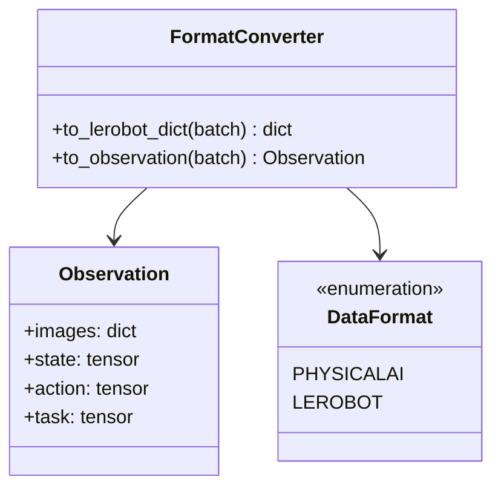
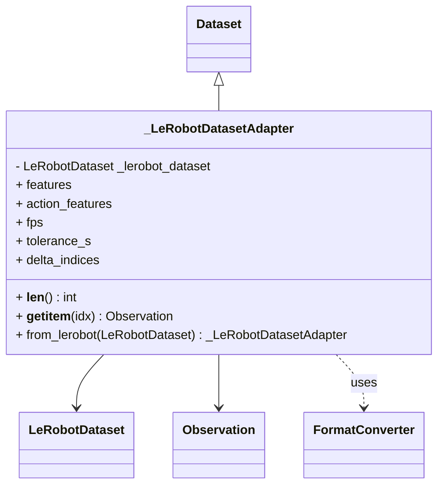
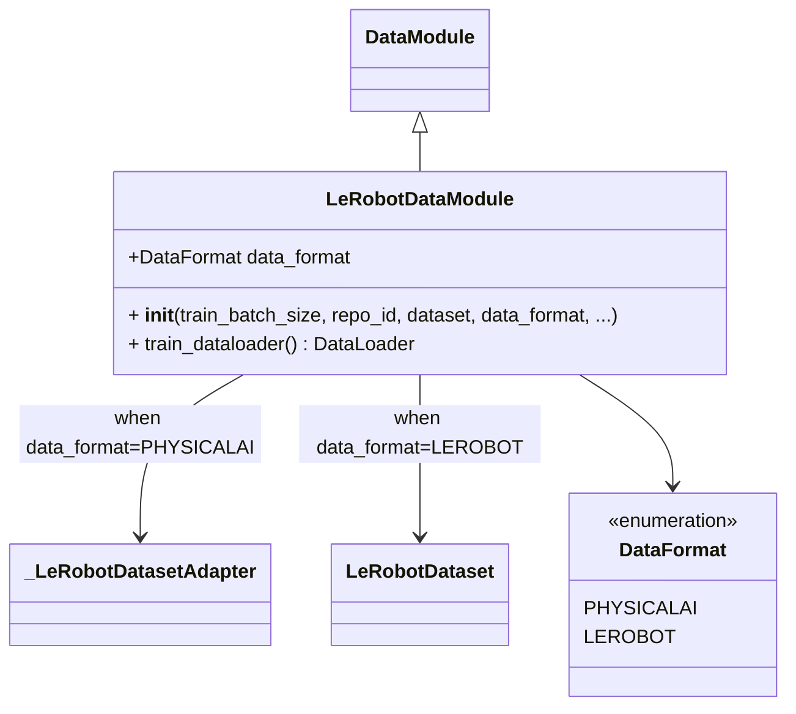

# LeRobot Data Integration

## Architecture Overview

The LeRobot data integration is organized into three focused modules:

```text
physicalai/data/lerobot/
├── converters.py      # Format conversion utilities
├── dataset.py         # Dataset adapter
└── datamodule.py      # Lightning DataModule
```

### Module Responsibilities

- **`converters.py`**: Bidirectional format conversion between
  PhysicalAI's `Observation` and LeRobot's flattened dict format
- **`dataset.py`**: `_LeRobotDatasetAdapter` wraps `LeRobotDataset`
  for PhysicalAI compatibility
- **`datamodule.py`**: `LeRobotDataModule` provides PyTorch Lightning
  integration

## Format Conversion

### Two Data Formats

1. **PhysicalAI Format**: Structured `Observation` dataclass with typed fields

   ```python
   Observation(
       images={"top": tensor, "wrist": tensor},
       state=tensor,
       action=tensor,
       ...
   )
   ```

2. **LeRobot Format**: Flattened dictionary with dot-notation keys

   ```python
   {
       "observation.images.top": tensor,
       "observation.images.wrist": tensor,
       "observation.state": tensor,
       "action": tensor,
       ...
   }
   ```

### FormatConverter

The `FormatConverter` class provides zero-copy bidirectional conversion:



**Usage:**

```python test="skip" reason="requires physicalai install"
from physicalai.data.lerobot import FormatConverter

# Convert to LeRobot format
lerobot_dict = FormatConverter.to_lerobot_dict(observation)

# Convert to PhysicalAI format
observation = FormatConverter.to_observation(lerobot_dict)
```

## LeRobotDatasetAdapter

Internal adapter that makes `LeRobotDataset` compatible with the
`physicalai.data.Dataset` interface.



**Note:** This is an internal class. Users should use `LeRobotDataModule` instead.

Example (these examples will download data onto your disk):

```python test="skip" reason="requires physicalai install and downloads data"
# Internal usage - not recommended for end users
from physicalai.data.lerobot.dataset import _LeRobotDatasetAdapter

pusht_dataset = _LeRobotDatasetAdapter(repo_id="lerobot/pusht")

# Preferred: Use LeRobotDataModule instead
from physicalai.data.lerobot import LeRobotDataModule
datamodule = LeRobotDataModule(repo_id="lerobot/pusht", train_batch_size=32)
```

## LeRobotDataModule

PyTorch Lightning DataModule for LeRobot datasets with configurable output formats.



### Data Format Selection

The `data_format` parameter controls the output format:

- **`"physicalai"`** (default): Returns `Observation` dataclass instances
- **`"lerobot"`**: Returns flattened dict in LeRobot's native format

Example (this will download data to disk if not cached already):

```python test="skip" reason="requires physicalai install and downloads data"
from physicalai.data.lerobot import LeRobotDataModule, DataFormat

repo_id = "lerobot/pusht"

# Option 1: PhysicalAI format (default)
datamodule = LeRobotDataModule(
    repo_id=repo_id,
    train_batch_size=16
)

# Option 2: LeRobot format (for LeRobot policies)
datamodule = LeRobotDataModule(
    repo_id=repo_id,
    train_batch_size=16,
    data_format="lerobot"  # or DataFormat.LEROBOT
)

# Option 3: From existing LeRobotDataset
from lerobot.datasets.lerobot_dataset import LeRobotDataset
dataset = LeRobotDataset(repo_id=repo_id)
datamodule = LeRobotDataModule(
    dataset=dataset,
    train_batch_size=16,
    data_format="lerobot"
)
```

## Goal Conditioning

Set `goal_source` to attach a goal to every sample as `Observation.goal_images`.
Task mode uses one split-local representative frame per task; episode mode uses a
frame from each sample's own episode:

```python test="skip" reason="requires physicalai install and downloads data"
from physicalai.data.lerobot import LeRobotDataModule

datamodule = LeRobotDataModule(repo_id="lerobot/libero", goal_source="task")
```

The wrapper selects one goal row per episode and task without decoding images. At
sample time it uses the observation's task or episode index to read the selected goal
through the normal wrapped dataset, so configured training transforms apply
independently to both reads.

Use `episode_goal_frames` (a dict or JSON object) to select relative frame offsets:

```python
datamodule = LeRobotDataModule(
    repo_id="lerobot/libero",
    goal_source="episode",
    episode_goal_frames={0: -1, 1: -3},
)
```

> **Note:** Train and validation resolve indices independently, so goals cannot cross
> the episode split.

See [Goal Conditioning](goal-conditioning.md) for wrapping datasets yourself and
rollouts with `GoalConditionedGym`.
