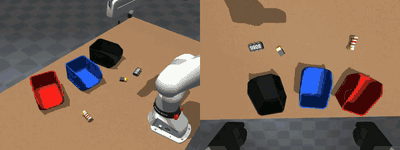
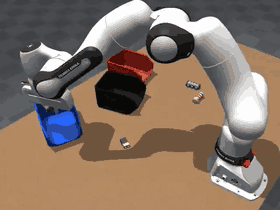
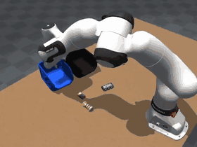

# pi05 on bucket_sort

The scripts behind the October 2026 bucket_sort experiments, which took pi05 from 29% to 90% success
in the MuJoCo sim. They cover data generation with a scripted IK demonstrator, DAgger recovery data,
training with physicalai or LeRobot, closed-loop evaluation and an interactive language demo.

These are experiment scripts, not library code: they import `physicalai`, LeRobot and the MuJoCo
plugin directly and were run on a 4×H100 server.

## The task

A Franka FR3 in the MuJoCo bucket_sort scene gets one instruction such as "put the 9 V battery in the
black bucket", picks the named object (resistor, 9 V battery or CPU) and drops it in the named bucket
(red, black or blue). The policy sees an overview camera, a wrist camera and the 8-D joint state at
30 Hz. An episode succeeds when the object lands in the named bucket within 30 s.

| Trained policy (overview and wrist camera)                                 | IK demonstrator recording data                                       | DAgger: the demonstrator takes over                                                        |
| -------------------------------------------------------------------------- | -------------------------------------------------------------------- | ------------------------------------------------------------------------------------------ |
|  |  |  |

## Results

Success on held-out layouts, cameras in their training slots, same 1,589 episodes unless noted.

| Model                                           | Success     |
| ----------------------------------------------- | ----------- |
| Studio pi05, 250 recorded episodes, bf16        | 29% (26/90) |
| physicalai, bf16 (default), 12k steps           | 53% (32/60) |
| bf16 fine-tune of the Studio model on this data | 68% (41/60) |
| LeRobot trainer, fp32, 12k steps                | 88% (79/90) |
| physicalai trainer, fp32, 12k steps             | 90% (54/60) |

Every run was a full fine-tune (no LoRA) from `lerobot/pi05_base`, except the fine-tune row, which
started from the Studio model.

## Where things stand (27 Oct 2026)

What we know:

- **Camera order was the biggest problem.** Re-scoring the same checkpoints with each camera in its
  training slot took physicalai fp32 from 28% to 90% and the bf16 fine-tune from 41% to 68%.
- **fp32 beats bf16 by ~37 points** on the same data and recipe (90% vs 53% at 12k steps). With no
  fp32 master copy, about 2% of the language model's weights change at all in bf16.
- **physicalai and LeRobot train equally well** once cameras are right (90% vs 88%).
- **The Studio model's 29% is real.** Its cameras were never swapped. Its dataset has 6× fewer
  episodes, follower positions as actions (the gripper action during a grasp is the object's width,
  never "close") and no recovery data.

Open questions, roughly in order of value:

1. **Cheaper than full fp32.** fp32 needs ~71 GB per GPU at batch 8. Not tried yet: bf16 compute with
   an fp32 master copy, 8-bit AdamW, LoRA (`train.py --lora`).
2. **Data or precision for the Studio model.** An fp32 retrain on Studio's 250 episodes would separate
   the two.
3. **Merged-dataset stats.** The 1st/99th percentile stats of `gen_dag` are far too narrow for some
   joints (joint 0: −18…42° stored, −91…124° real), so pi05's state tokens saturate. Recompute them
   and retrain once.
4. **Conclusions drawn while cameras were swapped** need re-checking: checkpoint selection by
   validation loss, inference tweaks (zero noise, shorter chunks, wider gripper) and the slip diagnosis.

Not verified:

- The runs used physicalai at `1cc910b` (0.3.1.dev13). These scripts have not been re-run on current
  main, which has since added #1340 (pi05 vision key loading).
- The shell launchers were rewritten for sharing and are only syntax-checked. The Python scripts are
  the ones that produced the results.

## Setup

1. The physical-ai-studio library environment (`library/`, `uv sync`), plus `lerobot==0.6.0` and
   `accelerate`. The runs used torch 2.11, transformers 5.15.1, lightning 2.6.6 and mujoco 3.17.
2. The MuJoCo plugin with the bucket_sort scene and the IK demonstrator, from the
   `max/mujoco-bucket-sort-recording` branch of openvinotoolkit/physicalai (PR #404, stacked on #400):

   ```bash
   git clone -b max/mujoco-bucket-sort-recording https://github.com/openvinotoolkit/physicalai.git
   uv pip install -e physicalai/packages/physicalai-mujoco-plugin
   ```

3. Point the launchers at a big disk. Every launcher sources `env.sh`, which `cd`s into `$WORK` and
   keeps datasets, runs, logs and the HF cache there.

   ```bash
   export WORK=/mnt/data/$USER/bucket_sort_pi05   # the default
   export PY=/path/to/library/.venv/bin/python     # default: python
   ```

## Data

Two public LeRobot v3.0 datasets on Hugging Face:

| Dataset                                                                                      | Episodes | Frames | Contents                                                                                    |
| -------------------------------------------------------------------------------------------- | -------- | ------ | ------------------------------------------------------------------------------------------- |
| [`iMaxxgx/bucket_sort_gen_all`](https://huggingface.co/datasets/iMaxxgx/bucket_sort_gen_all) | 1,199    | 431k   | IK demonstrator, commanded actions, randomized speed, grasp offset, yaw and gripper opening |
| [`iMaxxgx/bucket_sort_gen_dag`](https://huggingface.co/datasets/iMaxxgx/bucket_sort_gen_dag) | 1,589    | 561k   | `gen_all` plus 390 DAgger recovery episodes                                                 |

```bash
hf download iMaxxgx/bucket_sort_gen_dag --repo-type dataset --local-dir $WORK/data/gen_dag
```

On the h100s server they are also in `/mnt/data/xiangxi2/xiangxi2_vla/data/`. Both list their
cameras overview first; the Studio-recorded `bucket_sort` dataset lists them wrist first. Episode
seeds start at 10,000,000, so the evaluation seeds 100000-100089 are held out.

## Files

| File                                                              | What it does                                                                   |
| ----------------------------------------------------------------- | ------------------------------------------------------------------------------ |
| `env.sh`                                                          | Paths (`$WORK`, `$S`, `$PY`) and rendering settings; every launcher sources it |
| `generate.sh`, `gen_bucket_sort.py`                               | Record IK-demonstrator episodes, one headless worker per process               |
| `dagger.sh`, `gen_dagger.py`                                      | Record DAgger recoveries from the states a trained policy reaches              |
| `merge_gen.py`                                                    | Merge per-worker datasets into one                                             |
| `train.sh`, `train.py`                                            | physicalai training, the way Studio's training job runs it; fp32 or bf16       |
| `train_lerobot.sh`, `lerobot_train_ddp.py`                        | LeRobot's pi05 trainer, fp32, with the transformers 5 vision key fix           |
| `eval_bucket_sort.py`                                             | Closed-loop eval on held-out seeds: outcome per episode, summary, videos       |
| `demo.sh`, `demo_server.py`, `demo_page.html`, `msgpack_numpy.py` | Browser demo: type an instruction, watch the policy                            |
| `weight_change.py`                                                | Fraction of weights that changed between two checkpoints                       |
| `pai_to_lerobot.py`                                               | Run physicalai pi05 weights through LeRobot's inference                        |

## Pipeline

Source `env.sh` first: it sets `$S` (this folder), `$PY` and `$WORK`, and `cd`s into `$WORK`, so the
relative paths below are under `$WORK`. Never render on a GPU that is training.

```bash
source library/examples/bucket_sort_pi05/env.sh

# 1. Record demonstrations: 8 workers × 150 kept episodes; 15% start from a pose the policy gets
#    stuck in. Use seed bases of 10,000,000 and up: evaluation uses seeds 100000-100089.
GPUS="0 1" bash $S/generate.sh gen_new 8 150 10000000 0.15
$PY $S/merge_gen.py data/gen_new_merged --keep data/gen_new

# 2. Train. fp32 is the recipe that reached 90%; bf16 is physicalai's default.
bash $S/train.sh fp32 data/gen_dag runs/my_fp32 0,1
bash $S/train.sh bf16 data/gen_dag runs/my_bf16 0
bash $S/train_lerobot.sh data/gen_dag runs/my_lerobot 0,1

#    Fine-tune an existing checkpoint instead of pi05_base (the ft1 recipe, bf16):
CUDA_VISIBLE_DEVICES=0 HF_HUB_OFFLINE=1 $PY $S/train.py --policy pi05 --data data/gen_all --out runs/my_ft \
  --init-ckpt path/to/model.ckpt --batch-size 16 --max-steps 14000 --ckpt-every 2000 --val-every 4000 \
  --val-split 0.03 --limit-val 50

# 3. Evaluate on the held-out layouts: set A is seeds 100000-100029, set B 100030-100059.
CUDA_VISIBLE_DEVICES=0 MUJOCO_EGL_DEVICE_ID=0 HF_HUB_OFFLINE=1 $PY $S/eval_bucket_sort.py \
  --policy pi05 --ckpt runs/my_fp32/stepstep=12000.ckpt --out runs/ev_my_fp32_A \
  --episodes 30 --seed0 100000 --videos 4
#    A LeRobot run: --lerobot --ckpt runs/my_lerobot/checkpoints/012000/pretrained_model

# 4. DAgger: the policy drives, the demonstrator takes over, only the takeover is recorded.
bash $S/dagger.sh dag1 runs/my_fp32/stepstep=6000.ckpt 4 80 31000000 0
$PY $S/merge_gen.py data/gen_dag_new --ds data/gen_dag --keep data/dag1

# 5. Language demo in the browser on port 8090: type an instruction and watch the policy.
bash $S/demo.sh start pi05 runs/my_fp32/stepstep=12000.ckpt 0
bash $S/demo.sh stop
```

`eval_bucket_sort.py` writes `summary.json` and one JSON line per episode, with an outcome of
`success`, `wrong_bucket`, `fail_no_grasp`, `fail_slipped` or `fail_dropped`. One set of 30 episodes
moves about ±9 points by chance, so compare at least two sets.

## Pitfalls we hit

- **Camera order.** physicalai's pi05 fills its image slots in the order the batch dict lists the
  cameras, not by name. A model trained on overview-first data and fed wrist-first images silently
  scores 28% instead of 90%. The eval, DAgger and demo scripts read the training order from the
  checkpoint and print `camera order fed to the policy`. Exported models get the fix in the runtime
  (openvinotoolkit/physicalai#411).
- **bf16 barely trains.** pi05 defaults to `dtype="bfloat16"` with no fp32 master copy, so most AdamW
  updates round to zero. Use `train.sh fp32`. fp32 needs about 71 GB per GPU at batch 8, so it runs
  on 2 GPUs, and `train.py` turns on DDP's `gradient_as_bucket_view` to fit.
- **LeRobot 0.6 with transformers 5** skips pi05_base's 437 vision weights and leaves the encoder at
  random init. `lerobot_train_ddp.py` patches the key names; check the log for "All keys loaded".
- **Disk.** `train.py` keeps `best.ckpt`, `last.ckpt` and `stepstep=N.ckpt` at every save: 9.4 GB
  each in bf16, 16.6 GB in fp32. Keep `$WORK` off a shared root disk.
- **Rendering GPU.** MuJoCo picks its render GPU from `MUJOCO_EGL_DEVICE_ID`, not
  `CUDA_VISIBLE_DEVICES`. On h100s, rendering on GPU 2 stalls about 19 s per frame when the same process
  also uses CUDA there; use GPUs 0, 1 or 3.
- **Other scenes.** The generator and DAgger scripts use the plugin's `BucketSortDemonstrator`; a new
  task needs its own demonstrator in the plugin.
